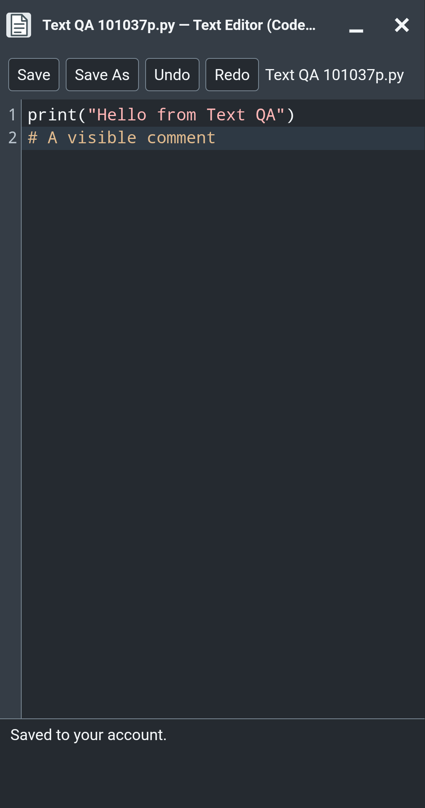

# Text Editor phone qualification

Launch **Office → Text Editor (CodeMirror 6)**. The WebOS entry is `webos/index.mjs`. The viewer bundles it with the shared editor at `libraries/codemirror/index.mjs`. The candidate used Text `2ead172`, CodeMirror `04feb7d`, and viewer `568dc73168cc`.

The app has seven everyday workflows. Create, edit and save a file. Open a saved file in Files. Save a separate copy. Undo and redo. Copy and paste. Recover an unsaved draft or retry after a failed save. Read code in the surrounding appearance. The phone pass covered five of those workflows. Desktop Chromium also copied and pasted the multiline Unicode example with keyboard shortcuts.

1. On the Galaxy S10+ in Chrome `158.0.8127.92` at 411 CSS pixels, type `Hello from Text QA` and a second line with Unicode. Save remains reachable above the keyboard.
2. Open Save and cancel once. The full edit remains. Enter a bare name on the next save. Files shows the new `.txt`.
3. Update the text, Undo, Redo and save to the same path. Close Text Editor and open the file through My files.
4. Save a copy with an explicit `.py` extension and type a Python string and comment. Save again and then save another copy with a bare name. It keeps the `.py` extension.
5. Sign in from a fresh context. Open both the updated text file and the Python copy from My files. Both reopen with their exact editable content.

The editing surface, gutter and Python syntax followed the dark WebOS scheme. The test also set a light scheme on the surrounding page and confirmed the same open document adapted without losing text. The appearance check did not depend on a browser-wide preference.

The desktop and tablet checks use Chromium. Fifteen Text unit checks passed. The basic file and editing workflow is qualified. Broader file-format coverage and draft recovery under failure remain separately tracked.
